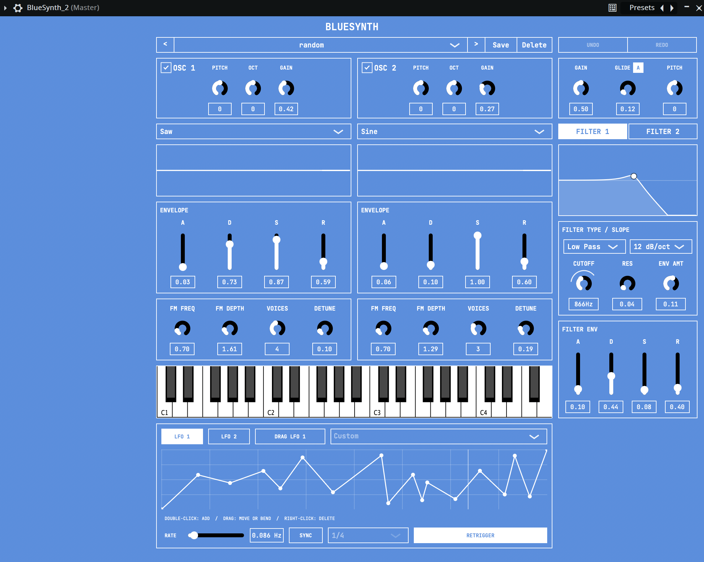

# BlueSynth

A dual-oscillator subtractive/FM synthesizer built with C++17 and JUCE 8. Available as **VST3**, **AU**, and a **standalone macOS app**.

[Features](#features) · [Build and install](#build-and-install) · [Tests](#tests) · [Architecture](docs/architecture.md) · [Source map](#source-map)



*Earlier UI snapshot; the current filter panel also includes a slope selector.*

## Features

### Oscillators, FM, and unison

Each oscillator has independent enable, gain, waveform, tuning, FM and unison controls.

| Control | Current implementation |
| --- | --- |
| Waveforms | Sine, Saw, Saw Inverse, Square, Triangle, Pulse 1, Pulse 2, Noise, Square BL, Saw BL, Rectified, Trapezoid, Stepped |
| Unison | 1–8 carrier copies per bank, stereo spread, detune and gain normalization |
| Tuning | ±4 octaves and ±24 semitones per oscillator, plus a global ±24-semitone offset |
| FM | Independent sine modulator per carrier; frequency and depth range from 0–1000, with depth used as frequency deviation in Hz |
| Gain | Separate oscillator gains followed by master gain |

Both oscillators run in parallel; oscillator 2 does not modulate oscillator 1. FM is bypassed when either FM frequency or depth is zero.

Square BL and Saw BL use fixed harmonic sums. They reduce harmonic content but are **not alias-free at every pitch**. Pitch-dependent band-limiting and lookup tables are future work.

### Filters and envelopes

Each oscillator has a filter, amplitude ADSR and filter ADSR. FILTER 1/2 tabs select visible controls; both enabled oscillator chains continue processing.

| Filter type | Slopes |
| --- | --- |
| Low-pass | 12, 24, 36, 48 dB/oct |
| High-pass | 12, 24, 36, 48 dB/oct |
| Band-pass | 6, 12, 18, 24 dB/oct **on each side** |

- Cutoff spans 20 Hz–20 kHz. Resonance emphasizes the cutoff region.
- Positive envelope amount raises cutoff, negative amount lowers it, and zero amount removes the filter envelope's influence.
- Attack/decay span 0–1 second, sustain 0–1, and release 0–3 seconds for both envelope types.
- Envelopes restart for newly assigned notes and advance while an oscillator is disabled.
- Low-pass at 20 kHz is bypassed. Positive modulation at that ceiling cannot raise it further.
- Filter release does not extend a note beyond its amplitude release.

The filter envelope amount moves by that fraction of the remaining distance on the logarithmic frequency graph, toward 20 Hz for negative amounts or 20 kHz for positive amounts. For example, a −0.57 amount moves a 2.4 kHz base to about 157 Hz at the envelope peak, 57% of the way to the graph's left edge. The dot reaches the edge only at full negative amount. Older presets and projects now use this mapping too, so their filter sweeps can sound different. Amount has a zero snap region below an absolute value of 0.05.

The response graph uses a logarithmic 20 Hz–20 kHz x-axis, so equal ratios occupy equal widths. Its 60 Hz display can skip intermediate positions during a 10 ms decay; the audio filter still follows the envelope each sample.

Steeper slopes use more stages and CPU. The default reproduces the original two-pole response; older presets without slope settings restore that default. See [filter implementation](docs/architecture.md#filters-and-envelopes) for stage and resonance details.

### Notes, glide, and MIDI

- **32-note polyphony**, with voice stealing enabled by the current JUCE default. Releases occupy voices too.
- Up to 16 carriers per note when both banks use eight-way unison.
- Global glide from 0–2 seconds, Serum-style: legato notes only unless ALWAYS is on, linear in semitones, with glide history local to each plugin instance.
- Glide retains its original host automation mapping; the editor uses linear knob travel. Saved glide durations remain in seconds. Normalized automation authored with the short-lived 0–1-second linear mapping cannot be distinguished automatically and may need adjustment.
- A 44-key piano sends notes through the host MIDI path. It spans MIDI notes 36–79 and labels middle C as C3.
- Mono and stereo output layouts.

Velocity-sensitive gain, pitch-wheel modulation, custom MIDI CC mappings and MPE are not implemented. JUCE handles standard note/pedal behavior, but pedal edge cases are not yet covered by the regression suite.

Master/oscillator gain and base filter cutoff/resonance changes use 10 ms ramps. Carrier pitch changes use 50 ms smoothing with or without FM; new notes start at their assigned pitch. Filter-envelope timing is unchanged. Waveform, filter-type/slope, oscillator-enable and FM-depth switches are not crossfaded by this smoothing pass.

### LFO modulation

Two independent LFO tabs sit below the keyboard, with editable curves and Sine, Triangle, Ramp up, Ramp down and Square presets. Double-click to add a point (up to 32), drag a point to move it, drag a segment to bend it, and right-click an interior point to delete it.

Drag **DRAG LFO 1/2** onto any of the 23 rotary knobs or 16 envelope faders. A new assignment starts at zero depth and opens its depth control. Right-click a destination to assign or edit either source; each assignment supports signed depth, bipolar/unipolar operation, bypass and removal. Knob values remain the saved base settings. Thin range indicators and live markers show modulation separately.

- Rate: 0.05–20 Hz, or tempo sync from four bars to 1/64 with straight, dotted and triplet divisions (bar labels assume four quarter-note beats).
- Retrigger: a separate cycle starts with each note and continues through release. With retrigger off, voices share a free-running cycle; synced free mode follows host PPQ while playing. Missing tempo uses 120 BPM, and stopped transport continues on the sample clock.
- The curve stays visible while idle. Its moving playhead appears only while a voice is sounding, including the release tail, and refreshes at a target 120 Hz while active. Above 3 Hz, a dot on the curve replaces the full-height line to avoid multiple-looking bars.
- Master gain uses one processor-wide cycle; retrigger resets it on every note-on.
- Both sources add before destination clamping. Cutoff uses a logarithmic frequency range, pitch uses semitones, and octave/unison count remain discrete. Unison contributions crossfade over 5 ms.
- Assigned LFOs update attack, decay and release time during each active stage; sustain moves live too. An assigned Glide LFO updates duration throughout an active glide. Glide still requires a previous pitch and either legato playing or ALWAYS, and a zero duration moves immediately to the new note. The filter envelope moves the LFO-modulated base cutoff across the logarithmic frequency range.
- Curves, timing and routes are saved in presets and host state. Older states clear LFO assignments and restore the default sine/1 Hz/retrigger settings.

LFO rendering adds CPU work, especially with high polyphony, unison and moving filter coefficients. The regression runner prints an offline comparison; it does not measure a DAW's CPU meter or guarantee a host buffer deadline.

### Presets and project recall

Save, load, delete and step through XML presets in:

```text
~/Documents/BlueSynth/Presets/
```

Projects save the sound settings **and the last known preset name**. Editing the sound retains that name. Restoration uses the project's saved settings without reloading the preset file, so the name can remain visible if the file has been moved or deleted.

The top-right **UNDO** and **REDO** buttons step through parameter, routing and LFO-curve edits. Assigning or removing an LFO route is one undo step; loading a preset or restoring host state starts a fresh history. Host automation can also enter the current APVTS undo history.

Older projects without name metadata cannot recover the original name automatically. BlueSynth cannot infer a name from an external host preset that supplies no name metadata. The displayed name identifies the sound's origin; it does not guarantee a match with the preset file.

### Visual feedback

The interface uses bundled JetBrains Mono weights 400–800 from Google Fonts, with SF Mono as a system fallback. Font files and their [SIL Open Font License](Resources/Fonts/OFL.txt) are included for offline use.

- Two pitch-synchronized scopes, following a selected note rather than displaying a whole chord's sum.
- Amber borders indicate an oscillator sum reaching full scale; red indicates output reaching full scale. These are meters, not limiters.
- A filter curve showing type, slope, live resonance and envelope-modulated cutoff, including base-value updates while idle.
- Scope display shaping that affects only the picture.

## CPU and latency

CPU depends on active notes, release tails, enabled oscillators, unison, FM, filter modulation and slope. Filters run **after** each unison bank is mixed, once per oscillator bank per note.

Current optimizations include a range-reduced sine polynomial, cached filter coefficients, and buffers allocated during preparation for the normal block-size path. These do not guarantee a particular host CPU percentage.

BlueSynth reports no added processing latency and uses no lookahead. Actual playback latency also depends on the host, audio interface and driver. The reported three-second release tail is separate from latency.

[Historical CPU profiling](docs/cpu-profile-2026-09-06.md) describes an earlier build, not current performance.

## Build and install

Requirements: macOS, Xcode and JUCE 8. The inspected local checkout is JUCE 8.0.12; the generated project uses C++17.

The exporter references **`../../JUCE/modules` relative to this repository**, not `../JUCE`. `BlueSynth.jucer` is the source of truth. Generated `Builds/` files are Git-ignored, so a fresh checkout may need regeneration in Projucer. Configure other JUCE locations there.

With this directory layout, regenerate from the repository root:

```bash
../../JUCE/Projucer.app/Contents/MacOS/Projucer --resave BlueSynth.jucer
```

Build the release:

```bash
xcodebuild -project Builds/MacOSX/BlueSynth.xcodeproj \
  -scheme "BlueSynth - All" -configuration Release build
```

Alternatively, open the generated Xcode project and select **BlueSynth - All**. The current shared schemes are All and VST3; AU and Standalone Plugin are targets included by All.

| Output | Default location |
| --- | --- |
| Installed VST3 | `~/Library/Audio/Plug-Ins/VST3/BlueSynth.vst3` |
| Installed AU | `~/Library/Audio/Plug-Ins/Components/BlueSynth.component` |
| Standalone app | `Builds/MacOSX/build/Release/BlueSynth.app` |

The All build replaces installed plugins. Fully quit and reopen the host to unload the old binary; rescan if needed. Overriding the build output directory does not disable installation steps.

After adding, removing or renaming source files, update the .jucer project and regenerate with Projucer. Do not hand-edit Xcode's file list.

## Tests

```bash
./Tests/run.sh
# Equivalent:
bash Tests/run.sh
```

The runner builds Shared Code and executes **28 regression groups** for FM output, instance isolation, preset state, filters, MIDI releases, envelopes, voice-reuse pitch, glide compatibility, smoothing, undo/redo and LFO routing/timing/state/UI. It also prints an offline dense-polyphony timing comparison. It does not install plugins or modify preset files. Processor construction may create the preset directory if absent.

See [test coverage and limitations](Tests/README.md). Offline passes do not establish FL Studio project compatibility, perceived sound quality or a CPU ceiling.

## Source map

| File or directory | Responsibility |
| --- | --- |
| **[Source/](Source)** | |
| [PluginProcessor](Source/PluginProcessor.cpp) / [header](Source/PluginProcessor.h) | MIDI, voices, project state, master output and meters |
| [PluginEditor](Source/PluginEditor.cpp) / [header](Source/PluginEditor.h) | Layout, parameter attachments and timer |
| [SynthVoice](Source/SynthVoice.cpp) / [header](Source/SynthVoice.h) | Oscillator banks, tuning, filters, envelopes and note lifecycle |
| [SynthSound.h](Source/SynthSound.h) | Note/channel eligibility |
| **[Source/Data/](Source/Data)** | |
| [Modulation](Source/Data/Modulation.cpp) / [header](Source/Data/Modulation.h) | LFO timing, routing and shapes |
| [ParameterLayout.cpp](Source/Data/ParameterLayout.cpp) | Ordered host parameter definitions |
| [WaveformChoices.h](Source/Data/WaveformChoices.h) | Shared waveform menu and saved choice order |
| [OscData](Source/Data/OscData.cpp) / [header](Source/Data/OscData.h) | Waveforms and FM |
| [FilterData](Source/Data/FilterData.cpp) / [header](Source/Data/FilterData.h) | TPT filter cascade and coefficient caching |
| [AdsrData](Source/Data/AdsrData.cpp) / [header](Source/Data/AdsrData.h) | JUCE ADSR parameter wrapper |
| [PresetManager](Source/Data/PresetManager.cpp) / [header](Source/Data/PresetManager.h) | Preset files, current name and change notification |
| [VisualizerBuffer](Source/Data/VisualizerBuffer.cpp) / [header](Source/Data/VisualizerBuffer.h) | Accumulation, metering and display FIFO |
| **[Source/UI/](Source/UI)** | |
| [LfoComponent](Source/UI/LfoComponent.cpp) / [header](Source/UI/LfoComponent.h) | LFO curve and timing panel |
| [ModSlider](Source/UI/ModSlider.cpp) / [header](Source/UI/ModSlider.h) | LFO destination controls |
| [TopControlLookAndFeel](Source/UI/TopControlLookAndFeel.cpp) / [header](Source/UI/TopControlLookAndFeel.h) | Drawing for top-row knobs, buttons and selectors |
| [OscComponent](Source/UI/OscComponent.cpp) / [header](Source/UI/OscComponent.h) | Oscillator controls |
| [ADSRComponent](Source/UI/ADSRComponent.cpp) / [header](Source/UI/ADSRComponent.h) | Envelope controls |
| [FilterComponent](Source/UI/FilterComponent.cpp) / [header](Source/UI/FilterComponent.h) | Filter controls |
| [FilterPanelComponent](Source/UI/FilterPanelComponent.cpp) / [header](Source/UI/FilterPanelComponent.h) | Filter panel layout |
| [FilterCurveComponent](Source/UI/FilterCurveComponent.cpp) / [header](Source/UI/FilterCurveComponent.h) | Filter response curve |
| [OscilloscopeComponent](Source/UI/OscilloscopeComponent.cpp) / [header](Source/UI/OscilloscopeComponent.h) | Waveform display |
| [PianoComponent](Source/UI/PianoComponent.cpp) / [header](Source/UI/PianoComponent.h) | On-screen keyboard |
| [PresetComponent](Source/UI/PresetComponent.cpp) / [header](Source/UI/PresetComponent.h) | Preset selector |
| [AppFont.h](Source/UI/AppFont.h) | Shared UI font helper |
| **[Tests/](Tests)** | |
| [Tests/](Tests) | Feature-grouped regression sources, shared helpers, and the [runner](Tests/run.sh) |
| [README.md](Tests/README.md) | Test coverage and limitations |
| **Other** | |
| [Architecture guide](docs/architecture.md) | Ownership, signal flow, state and threading |
| [AGENTS.md](AGENTS.md) | Shared agent instructions, imported by CLAUDE.md |

## Roadmap

Planned, not implemented:

- Shared waveform lookup tables and pitch-aware band-limiting.
- Additional modulation sources and destinations.
- Reverb, delay, chorus and other effects.
- Factory presets and AI-assisted preset generation.

Further validation targets include sustain pedals, rapid repeated notes, automation during release, and audible discontinuities when switching filter types/slopes at high resonance.

## License

No project license has been declared. JUCE is separately licensed; see its bundled license and [JUCE's website](https://juce.com).
